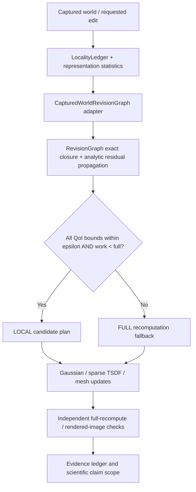

# MAVEB/CBRC: from a captured-world edit to a certified revision cone

This document connects the *scientific hypothesis* to the actual code.
It is a companion to the [linked source inventory](SOURCE_READING_ORDER.md),
not a replacement for the frozen
[CBRC claim ledger](../research/results/CBRC_CLAIM_LEDGER_2026-09-24.md)
or the [experiment runbook](../research/results/CBRC_EXPERIMENT_RUNBOOK.md).

## 1. What a persistent captured world changes

AETHER provides the capture, reconstruction, retained-world and render
infrastructure. MAVEB's question is different: after an entity/material/
geometry edit, how much dependent representation work is unavoidable before
the output can be declared within a requested tolerance?

The answer cannot be “only update nearby voxels.” An edit may influence
meshing, Gaussian density tails, texture pages, GPU publication and temporal
history outside a geometric box. Ignoring those dependencies can produce a
fast but wrong result. The system represents a change using *work units*,
exact dependencies, conservative analytic error bounds, and quantities of
interest (QoIs).

The diagram distinguishes planning from execution and scientific validation.
A planner-returned certificate cannot by itself prove that a renderer or
mesher implemented its planned work correctly.

## 2. Understand the graph and its mathematical invariants

Read
[`engine/revision/include/aether/revision/RevisionPlanner.hpp`](../engine/revision/include/aether/revision/RevisionPlanner.hpp)
and
[`engine/revision/src/RevisionPlanner.cpp`](../engine/revision/src/RevisionPlanner.cpp).

Each `RevisionNode` has a calibrated work cost and change bound.
`RevisionEdge` distinguishes an *exact predecessor* dependency (must be
inside the repaired cone) from analytic propagation (an external residual
can be conservatively bounded if the dependency remains outside).
`RevisionQoI` names a weighted observation and an epsilon tolerance.

`RevisionGraph::closeExactPredecessors` repeatedly walks required
predecessors until it reaches a fixed point. Thus a supposedly cheap cone
cannot omit a mandatory earlier representation operation.

`certifyRevisionCone` first validates the closure. It then sets residual
bounds inside the cone to zero, propagates conservative residual effects
through the exterior analytic DAG and sums each QoI's weighted bound.
A cycle in the analytic exterior is not silently treated as zero error:
the current v1 certificate fails closed.

`greedyCertifiedRevisionCone` tests candidate cone expansions, comparing
the violation-score improvement with added work. This is a *heuristic*,
not a globally minimal cone proof. If it cannot certify a cheaper
subset, it constructs a full-rebuild fallback.

**Exercise:** draw a three-node graph A -> B -> C with A -> B exact,
B -> C analytic. Try to certify {B} without A, then close the exact
predecessor and vary C's QoI tolerance. Read the certificate fields for
`stable`, `passes`, `work`, `fullWork` and `fullRebuild`.

## 3. The evidence-to-graph adapter

Read
[`engine/cbrc/include/aether/cbrc/CapturedWorldRevisionGraph.hpp`](../engine/cbrc/include/aether/cbrc/CapturedWorldRevisionGraph.hpp)
and
[`engine/cbrc/src/CapturedWorldRevisionGraph.cpp`](../engine/cbrc/src/CapturedWorldRevisionGraph.cpp).

The `world::LocalityLedger` counts actual representation activity:
inspected observations, meshed cells/patches, updated texture pages,
material states, inspected/updated Gaussians, GPU publication bytes and
invalidated temporal pixels. Incremental mesher statistics and
`CapturedWorldCostModel` turn these heterogeneous units into one
*calibrated work* model. It is invalid to compare bytes, pixels and cells
without declaring their coefficients.

`capturedWorldRevisionInputFromEvidence` verifies the required counter
coverage and rejects negative/nonfinite costs before deriving planner
inputs. `buildCapturedWorldRevisionGraph` assigns source/hard-closure
boundaries and a resolved-image RGB-L-infinity QoI. Finally,
`planCapturedWorldRevision` delegates to the generic planner.

**Important:** a smaller weighted work total does **not** imply a
correspondingly smaller measured wall-clock time. GPU synchronization,
memory traffic, queueing and fixed overheads can change observed timing.
Keep theoretical/calibrated and observed performance measurements apart.

## 4. Representation work is concrete, not just a graph vertex

The Gaussian ownership/edit side is in
[`engine/world_gaussian/src/GaussianLocalUpdate.cpp`](../engine/world_gaussian/src/GaussianLocalUpdate.cpp),
and spatial lookup/ownership helpers live in the adjacent modules.
An indexed selection avoids traversing every splat but must produce
semantically equivalent results to the unindexed reference operation.

A Gaussian with a wide covariance can affect the exterior of a
nominally local edit. The
[`GaussianLocalityCertificate.cpp`](../engine/world_gaussian/src/GaussianLocalityCertificate.cpp)
uses rotated covariance, opacity and per-face tail estimates to bound
changed before/after primitive contributions outside a volume. This is
a **density-tail bound**, not by itself a final image-space RGB bound.
Read the
[`GaussianImageRevisionCertificate.cpp`](../engine/world_gaussian/src/GaussianImageRevisionCertificate.cpp)
and
[`GaussianRenderCertificate.cpp`](../engine/world_gaussian/src/GaussianRenderCertificate.cpp)
when reasoning about rendered output.

Sparse TSDF representation is implemented in
[`engine/reconstruction/src/SparseTsdfVolume.cpp`](../engine/reconstruction/src/SparseTsdfVolume.cpp).
Capture validation, metric poses and depth confidence control voxel fusion.
Incremental meshing
([`IncrementalSparseTsdfMesher.cpp`](../engine/reconstruction/src/IncrementalSparseTsdfMesher.cpp))
has different lifetime and work units from Gaussian splat translation.
Neither may be substituted for the other without transforming both the
QoI and the work model.

**Exercise:** move a Gaussian near the edit boundary, compare indexed
and unindexed selection, and check whether the declared bound is density
tail, image error, or simply a count of selected splats.

## 5. Temporal effects and fallback behavior

Screen-space temporal history can reuse stale pixels even when local
geometry is correct. Read
[`TemporalRevisionCertificate.cpp`](../engine/scene/src/TemporalRevisionCertificate.cpp)
and [`TemporalRevisionCertificateTests.cpp`](../tests/TemporalRevisionCertificateTests.cpp).
A temporal history instability or uncertain exterior effect can require
wider invalidation or full rebuilding. A certificate should never infer
correctness from reduced CPU operations alone.

The core research rule is **fail closed**: if the graph is inconsistent,
the bound is nonfinite, an exact prerequisite is missing, or a required
QoI cannot be certified, refuse the smaller repair.

## 6. Evidence and tests, in order

1. [`tests/RevisionPlannerTests.cpp`](../tests/RevisionPlannerTests.cpp):
   closure, analytic DAG, failure and full fallback.
2. [`tests/GaussianLocalityCertificateTests.cpp`](../tests/GaussianLocalityCertificateTests.cpp):
   covariance/tail behavior.
3. [`tests/GaussianImageRevisionCertificateTests.cpp`](../tests/GaussianImageRevisionCertificateTests.cpp):
   rendered-image-oriented bounds.
4. [`tests/OracleGeometryTests.cpp`](../tests/OracleGeometryTests.cpp):
   independent geometry/reference checks.
5. [`tests/TemporalRevisionCertificateTests.cpp`](../tests/TemporalRevisionCertificateTests.cpp)
   and [`tests/SparseTsdfTests.cpp`](../tests/SparseTsdfTests.cpp):
   temporal/volume-specific cases.
6. [`research/results/CBRC_PAPER_GRADE_EVIDENCE_2026-09-24.md`](../research/results/CBRC_PAPER_GRADE_EVIDENCE_2026-09-24.md):
   frozen claim scope and actual measured evidence.

A **no-violation test result** means no violation was detected in
*those scenarios*; it is not proof for arbitrary captured scenes.
A certificate bound relies on its specified mathematical assumptions,
and an empirical runtime speedup must be demonstrated with matched
scene/host/compiler/policy repetitions. Record exact SHA and run command
for every result.

This text and the adjacent teaching comments add documentation only:
they neither alter frozen evidence nor assert a new benchmark, compile,
or review acceptance.
